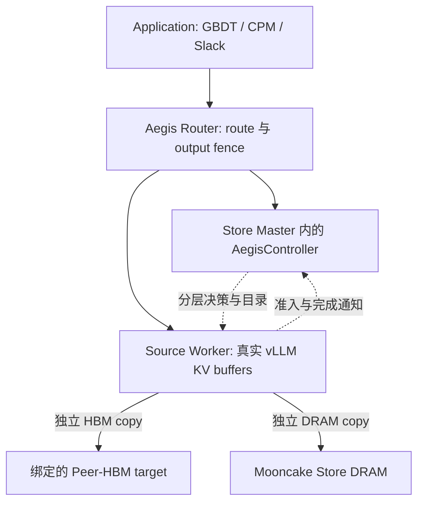

# Mooncake、Mooncake 上的 AegisKV、MoonKVSim 上的 AegisKV：设计与实现对比

**2026-09-06 算法修订说明：** 本文主体仍比较已经运行过的 Mooncake 与 `mooncake_prompt_v1` 实现。
新的[算法 2/3 revision 3 技术定义](../Archived/patent/ALGORITHMS_2_3_REVISION.md)
已经进入论文及可执行参考适配器，尚未替换这两条运行路径。参见文末第 16 节，避免把新设计与旧运行证据混合。

核对日期：2026-09-06。本文依据本机源码、配置、指定会话对应的实机产物，以及已验收模拟的冻结源码；代码位置和 SHA-256 见文末。比较对象是三个具体系统层次，而不是三个同等成熟度的独立产品。

配套的两张可编辑架构图与旧图索引见 [Draw.io 图件目录](../Archived/docs-legacy/drawio/README.md)：原生 Mooncake 的 KV 管理，以及增加 AegisKV 后的实现架构。

**核心区别：Mooncake 提供 KV 对象的共享存储、放置和传输基础；AegisKV 在它上面增加 workflow Slack 驱动的请求级保护、备用目标和恢复协议；MoonKVSim 则用全局离散事件与资源账本执行这些机制的模型。** 当前模拟已对齐主要 prompt 保护语义，但并未执行相同的推理、网络、预测器或全部并发协议。

阅读导航：先看第 2–4 节的职责、接口和状态所有权，再看第 5–8 节的三个算法，第 9 节用同一故障场景串联全过程。第 10–12 节回答“哪些已经对齐、哪些只是模型、实验能证明什么”，第 13–15 节提供代码入口、可用表述和来源指纹。

## 1. 比较对象、版本与证据口径

| 对象 | 本文采用的边界 | 版本与来源 | 不应混入的内容 |
|---|---|---|---|
| **M：原生 Mooncake** | Store、Transfer Engine、Conductor 及标准推理框架集成；说明其自身的对象缓存与故障处理能力 | 本地 Mooncake 的提交 `719735896c86b56fabec6cf3e825fb2ea640597a`；原生文件通过 Git 提交对象与工作树核对 | dirty 工作树中新加的 AegisController、Aegis Router 和 connector gate |
| **A：AegisKV on Mooncake** | 当前设计 + native C++ Controller + Python Application/Router + vLLM connector/HBM 执行路径 | 用户指定会话 `01a06fae-403a-7852-97c1-475ca121b4c8`；同一 Mooncake 工作树上的逐文件哈希 | 把设计要求、代码存在和实机试验通过视为同一件事 |
| **S：AegisKV on MoonKVSim** | 当前 `engine.json` 的 `mooncake_prompt_v1`，以及论文实际调用的运行管线 | MoonKVSim HEAD `b10886754ed4890285d1320cbb5fe679a9979166`；实际执行绑定 `source-v2` 的 383 文件清单 | `legacy_v3`、旧 200 次论文实验、source-v1 策略结果和仓库中未被本次 runner 调用的其他模型 |

两个工作树都有未提交改动。Git HEAD 用于标识历史基点，**不能单独标识本次实现**。本次重新校验：Mooncake 参考清单中的 17 个文件没有变化；`source-v2` 清单包含的全部 122 个 `python/moonkvsim/` 文件均与当前工作树一致。库文件一致不表示每个类都被论文 runner 调用；实际调用边界见第 3.5 节。[E-REF] [E-SNAPSHOT]

**本次复核更正：**先前对齐说明将实机 full-treatment 的 AIMD 周期写成 1 s，这是错误的。接受的实机 pilot 部署清单、Worker 配置均为 **5 s**，实际窗口日志也约每 5 s 一次；模拟仍是 **1 s**。本文第 8 节以这些实际证据为准。既有模拟结果仍对应其声明的 1 s 参数，本次没有修改执行代码或重跑实验。[E-DEPLOY] [E-WORKER] [E-AIMD-LOG]

还存在一个容易忽略的版本差异：MoonKVSim 最初的 **Vanilla Store/TE 基线锁在 `f161118c18dbea1b56dd5c7908b9eaa440353e2e`**，不是上述较新的 Mooncake 提交。因此，后来 Mooncake 新增的租户、HA、对象管理功能，不能因为“模拟了 Mooncake Store”就算作已模拟。本次 AegisKV 对齐也没有重写全部原生 Store API。[S-BASE]

下文采用四种表述：**设计**指规范想实现的行为；**代码**指当前可定位的实现；**实机观测**指实际运行产物；**模拟观测**指虚拟执行及其审计结果。未验证表示证据不足，不自动等于功能不存在。

## 2. 总览：目标、对象与系统职责

| 维度 | M：原生 Mooncake | A：AegisKV on Mooncake | S：AegisKV on MoonKVSim |
|---|---|---|---|
| 首要问题 | KV 共享、缓存容量扩展、数据传输和服务效率 | fail-stop 后，有限保护资源如何减少 workflow 可见的恢复损失 | 在明确模型假设下，执行上述策略并研究其 WCT、流量、容量和故障后行为 |
| 工作单位 | key/object、slice、replica、segment、transfer batch；上层 connector 可把 KV blocks 映射为对象 | workflow/branch/request，外加 route version、logical chunk、tier、shard 和备用目标 | workflow/span/request、逻辑 token 区间、物理容量分配、事件与 modeled flow |
| 应用依赖图 | Store/TE 不运行 agent DAG CPM | Application 维护因果可见的残余 DAG，生成 Slack | 冻结 DAG 和理想 span 时长，运行 residual CPM |
| 主要保留信号 | 对象访问、租约、pin、容量与可配置策略 | 每字节减少的本层恢复 harm，结合 Landlord rent 和 suffix 约束 | 同类 harm/rent 状态，以 Python 策略及精确账本计算 |
| 数据共享 | 标准 connector 支持跨实例 hash-based prefix reuse | 当前 Router 使用 request-specific cache salt，隔离不同请求的 KV 所有权 | 对齐模式同样隔离不同请求；不计无关请求的 prefix alias 收益 |
| 冗余目标 | 对象副本和共享缓存；实际策略由部署/上层决定 | 在路由绑定的 Peer-HBM 和 Store DRAM 中独立保护请求 KV | 建模独立两层；当前研究只给 prompt KV 保护收益 |
| 推理执行 | 与真实 vLLM/SGLang 等引擎协作 | 当前参考接入真实 vLLM，读取/写入真实 KV buffers | 不加载权重、不运行 CUDA 前向、不生成真实回答 |
| 服务拓扑 | 标准集成支持 prefill/decode 分离及共享 KV pool，具体路由由部署决定 | 本次接受的 pilot 为 DP 副本，每个 Worker 执行请求；未据此验证 P/D 分离部署 | 本次为 DP8，每 GPU 有独立连续批处理调度；没有把 prefill/decode 部署成两组实机服务 |
| 存储层范围 | TE 支持 DRAM/VRAM 数据移动，Store 可配置 SSD offload 等扩展 | 本设计的保护算法只管理 Peer-HBM 与 DRAM；SSD 仍属基础缓存策略范围 | 当前执行范围无 SSD/NVMe，不模拟所有上游存储层 |
| 故障后的单位 | 节点、连接、对象副本、缓存 miss；框架决定请求重试 | 请求执行权、输出 fence、已提交 prefix、silent replay、恢复目标 | GPU/HBM 故障域、版本/位置 fence、prefix load、重算与模拟 repair |
| 成功证据 | 对应部署下正确存取、传输与服务测试 | 实际请求 + 真实进程终止 + 物理恢复 + 清理 | 事件、资源、输出位置与 WCT 重建一致；不等于物理时延准确 |

原生 Mooncake 的官方 Store 文档说明了 Master/Client 分工及对象副本；vLLM 集成文档说明了共享 KV 和 prefix reuse。这些是 AegisKV 使用的基础能力。[官方 Store 文档](https://kvcache-ai.github.io/Mooncake/design/store/mooncake-store.html)、[官方 vLLM 集成文档](https://kvcache-ai.github.io/Mooncake/deployment/integrations/vllm/kv-cache-storage.html)。下文细节以文末锁定的本地版本为准。[M-STORE] [M-VLLM]

## 3. 架构、控制面与数据面

### 3.1 原生 Mooncake：对象目录与数据通路分离

Store Master 负责对象元数据、segment 资源、放置、副本状态、租约与淘汰。Store Client 一方面发起 Put/Get，另一方面可贡献注册内存，作为承载对象的节点。实际字节在 Clients/注册 buffers 之间经 Transfer Engine 移动，通常不经过 Master。[M-STORE]

Transfer Engine 负责地址注册、segment、传输批次、拓扑路径、NIC/端点、完成状态和传输错误处理。它支持 DRAM/VRAM 等地址空间；具备传到另一个 GPU 的能力，并不自动等于存在 AegisKV 的“为某请求绑定备用 GPU 并按 Slack 决定备份”策略。[M-TE]

Conductor 是面向 cache-aware router 的 prefix 索引：消费 KV 事件、维护 model/tenant/layout 等上下文、回答各实例的最长连续命中。它不等同于 AegisKV 的 workflow runtime，也不能从 prefix 命中数直接得到 branch Slack。[M-CONDUCTOR]

### 3.2 Mooncake 上的 AegisKV：在基础设施上增加请求协议

| 层次 | 新增/扩展模块 | 代码中的职责 | 仍由基础设施负责的事 |
|---|---|---|---|
| Application | Algorithm 1、预测器、Slack ticket | 观测进度、预测残余时间、CPM、校准后发布 Slack | 业务 workflow 和工具调用本身 |
| Router | `AegisRouter` / `AegisRouterService` | 兼容性过滤、primary/standby 绑定、route version、输出 fencing、恢复编排、结束清理 | 真实 HTTP/stream 服务和引擎请求执行 |
| Store Master | native `AegisController` | 请求/tier/chunk 元数据、SlackLandlord、AIMD、恢复计划、提交与幂等操作 | 原生对象存储、Store 放置、RPC 和字节承载 |
| Worker | `AegisKVConnector`、gate、HBM target agent | 封装完整 chunk、分别请求准入、实际复制、ACK、恢复加载、本地资源反馈 | vLLM 的主 KV page 管理、模型执行、CUDA/传输设施 |

`AegisKVConnector` 继承标准 `MooncakeStoreConnector`；`MasterService` 持有 `AegisController`，RPC 层调用其 `RegisterRequest`、`Admit`、`CompleteCopy` 等方法。这是可定位的扩展关系，不是仅在论文中把模块画在一起。[A-APP] [A-ROUTER] [A-SERVER] [A-CONNECTOR] [A-MASTER] [A-RPC]

图中实线到 Peer/Store 表示源侧数据通路；Controller 不接收 KV payload。Peer-HBM 与 DRAM 之间没有 AegisKV destage 箭头。两条复制可有不同的排队和完成时间。

### 3.3 MoonKVSim：用事件与账本表达同一类行为

`GlobalDES` 提供唯一的纳秒虚拟时钟和按时间、优先级、稳定序号排序的事件堆。`experiment.py` 的 `_StudyRuntime` 连接 workflow、逐 GPU 调度、AegisKV policy、Store DRAM 池模型、传输、故障与恢复。`CapacityLedger` / HBM authority 管理容量，网络/flow 模型管理资源竞争。[S-DES] [S-RUNTIME] [S-HBM] [S-FLOW]

其“Worker”“Master”“GPU”是模拟身份和状态，不是部署进程。代码中的 `physical` 指**模拟中的物理容量账本**，用于区别逻辑 block/alias，不能据名称解释为已经分配真实 GPU 显存。

模拟目录中还存在较早的 baseline、ODR、其他模型和规模 runner。判断论文行为应追踪 `run_mooncake_aligned_paper.py → run_experiment / _StudyRuntime → 当前策略与资源模块`，不能只根据某个类存在就认定它参与了本次 170 次执行。[S-RUNNER]

### 3.4 三种 DRAM 用途应分别理解

推理框架的本地 CPU cache、远端/共享 Mooncake Store DRAM、host-staged GPU copy 的临时主机 buffer 是不同概念。SGLang HiCache 的本地 DRAM L2 不应被直接叫作远端 Store L3；当前参考 AegisKV 接入的是 vLLM，也不自动继承完整 HiCache 层次。4090 路径经过主机中转，只说明实际 copy 实现需要 staging，不能把这些临时 bytes 计为一个独立、已经 COMMITTED 的 AegisKV DRAM 保护副本。[M-TE] [A-CONNECTOR] [A-HBM] [E-PILOT]

### 3.5 接口对应关系：论文究竟执行了哪条实现路径

MoonKVSim 的通用库提供 `AegisKVController.reserve_independently`、`AegisKVDirectory` 和 `DualPathPropagator`，配套 `MasterService` / `StoreDRAMPool`。但本次论文的 `_StudyRuntime` **没有实例化这套通用 Controller/Directory/Propagator 链路**。它在 `experiment.py` 内直接组织 `_ModeledPool`、`SlackLandlord`、`TransferRuntime`、连续批处理 driver 和容量账本。因此必须区分“仓库中有相应组件”和“170 次实验实际经过该组件”。[S-POLICY] [S-DIRECTORY] [S-PROPAGATION] [S-STORE] [S-DRAM] [S-RUNTIME]

| 操作 | M：原生接口与责任 | A：实际新增接口/调用 | S：当前论文实际执行入口 |
|---|---|---|---|
| 建立执行与保护身份 | 上层调度请求；Store 注册 segment、管理 object | Router + `RegisterRequest`，绑定 source、备用 HBM pool、route 和 layout | `_route_gpu`、`_bind_peer_target` 与 `_SpanExecution`；没有实际注册 RPC |
| 更新 Slack | 无 Aegis 请求 Slack API | Application `update_slack` → Controller `UpdateSlack` | `_update_residual_slack` → residual CPM → `_published_slack_signal` |
| 提交待保护 chunk | Client `PutStart` 请求对象空间，TE 搬运，`PutEnd` 发布 | connector seal → Controller `Admit`；HBM slot 与 DRAM object 分别执行 | `_schedule_continuous_sealed_protection_puts`、`_schedule_protection_puts`、各 pool 的 `SlackLandlord` |
| 确认复制完成 | 存储对象达到完整可读状态 | `CompleteCopy` 检查 shard ACK、route 和 layout；与准入返回分开 | `_on_protection_task_terminal` 先排 `PUT_COMMIT`；`_on_put_commit` 再提交 pool reservation 和 policy pending |
| 推进下一逻辑块 | 原生 Store 不维护请求级双层 ordinal gate | native connector 的 shared logical-key finalizer | `_resolve_continuous_protection_batch` → `_runtime_gate_resolve` |
| 释放/淘汰 | Store 删除对象或淘汰副本 | `Admit` / `EvictChunk` 返回待释放 chunk，Worker 执行实际删除 | `_formal_evict_committed_at_least` 等路径更新 `_ModeledPool`、Landlord 和账本 |
| 调节 Peer-HBM | 原生 Store 容量管理不是这一配额协议 | Worker 汇报压力 → `ControlWindow` → alpha 发布与目标执行 | `_on_aimd_control_window`、`HBMQuotaAIMD` 和 HBM authority |
| 故障切换与恢复 | Get 读取可用对象；请求恢复由上层定义 | `RebindRequest` / `GetRecoveryPlan`，gate 实际加载，`CompleteRecovery` | `_plan_recovery`、恢复传输/物化/重算事件；没有真实 HTTP 或 CUDA 完成通知 |
| 结束清理 | 可按缓存策略跨请求保留对象 | `CompleteRequest` 报告 pending 数和待回收 chunks，Router drain | `_complete_runtime_protection` 及终态 pool/账本检查 |

这些是职责对应关系，**不是兼容 API 列表**：S 的 `_ModeledPool.commit_reservation` 不等于调用 native `PutEnd`，模拟的 flow completion 也不等于收到真实设备 ACK。[M-STORE] [A-HEADER] [A-GATE] [S-RUNTIME] [S-AIMD]

## 4. 元数据、粒度、身份与生命周期

| 维度 | M | A | S |
|---|---|---|---|
| 对象身份 | Store key/object；上层可使用 token block hash | request、route、tier、ordinal、storage keys 共同约束保护身份 | 对应标识与账本 allocation ID；保留可审计的映射 |
| Prefix 粒度 | 由引擎/connector 配置；Store 本身不规定 4096-token 保护 chunk | 默认 4096 tokens；最后一个 prompt chunk 可短于 4096 | 当前策略 chunk 为 4096；prompt 区间来自确切 token IDs |
| Decode 粒度 | 由上层决定缓存/传输哪些 KV | 默认每 256 个 decode tokens seal；open tail 不保护 | 当前论文不保护 decode KV，仅重放已提交输出位置 |
| 调度 page / 容量 | 真实框架与 allocator 决定 | 参考 vLLM 为 16-token page；真正 buffer 按模型/layout 组织 | 逻辑 page 16 tokens，主 KV 物理分配按 64-token 单位计费；尾部可能更保守 |
| 可见条件 | 原生 Put 完成后对象可读 | 完成前向产生有效 buffer；本层完整 shard ACK 且版本兼容后才 COMMITTED | 完成 forward 事件后产生可保护 KV；传输完成与 policy commit 后可恢复 |
| 生命周期 | 可跨请求保留以复用，直到淘汰/删除/失效 | 请求私有保护在 CompleteRequest drain 后释放 | 同步建模 drain、释放与终态账本；最终保护用量必须为零 |
| 多副本 | 多个对象 replica，按放置配置 | HBM/DRAM 两份独立保护，可能覆盖相同前缀 | 不把重叠前缀的 token 覆盖量相加 |

来源：[M-STORE] [M-VLLM] [A-DESIGN] [A-CONNECTOR] [A-GATE] [S-HBM] [S-RUNTIME]。

**三个粒度不能混用：**16-token scheduler page、64-token 模拟分配单位、4096-token policy chunk 分别解决引擎分配、容量记账和保护决策。模拟的 64-token 尾部占用不代表给 workload 填充 token；也不能据此声称真实 vLLM allocator 的碎片完全相同。

### 4.1 元数据由谁保存，谁能使其生效

| 状态 | M：原生 Mooncake | A：Mooncake 上的 AegisKV | S：当前论文运行器 |
|---|---|---|---|
| KV 内容与地址 | payload 在注册内存，Master 保存对象/副本位置 | 源主 KV 归引擎 allocator；备用 slot 归目标 HBM agent；DRAM object 归 Store | token 区间、chunk key、pool entry 和容量字节；不存真实 K/V tensor |
| 对象可读性 | Store 对象副本状态、租约等 | 底层对象/slot 存在之外，还须通过 Aegis chunk 的 COMMITTED、版本和完整前缀检查 | `_ModeledPool` 的 committed/reservation 状态与 policy 元数据相互核对 |
| 请求执行权 | 由推理框架/router 维护 | Router route/output fence + Controller 中的 request registration | `_SpanExecution` 的 route、状态和已提交输出位置 |
| 分层保护前缀 | 不是原生 object directory 的请求语义 | Controller 维护 request/tier chunks；gate 另维护共享 logical frontier | formal chunk 元数据、分层 Landlord 和 runtime gate；既看策略状态也看实际池驻留 |
| 租金和保护配额 | 原生对象策略自己的状态 | Controller 中 pool rent/credit/alpha；Worker 执行并反馈 | `SlackLandlord`、`HBMQuotaAIMD`、各 GPU 的容量账本 |
| 持久化与重建 | 原生 Store 可配置 snapshot/HA | 新增 Controller 状态尚不能据此视为接入 Store HA | journal/输出能审计虚拟执行；没有在本次实验中模拟 Controller 重启和 HA 恢复 |

因此，A 中“Controller 认为存在一个保护 chunk”“目标上有 slot/object”“本次恢复允许读取它”是三个需要协议连接的事实。S 在同一进程内检查这些关系，不能据此覆盖 A 的进程间时序窗口。[M-STORE] [A-HEADER] [A-CONTROLLER] [A-HBM] [S-RUNTIME]

### 4.2 AegisKV 的数据契约具体增加了什么

以下字段来自 native header，而不是根据架构图推测；S 使用对应的模型字段和内部数据结构，没有逐字复用这些 C++ wire structs。[A-HEADER]

| native 数据结构 | 关键字段 | 解决的问题 |
|---|---|---|
| `RequestRegistration` | `request_id`、`model_revision`、`kv_abi`、`layout_id`、`source_failure_domain`、`designated_hbm_pool_id`、`route_version`、`full_recompute_ms` | 把保护副本绑定到正确请求、布局、源故障域和备用目标 |
| `SlackUpdate` | `slack_lower_ms`、`observed_at_ms`、`version`、`valid`、`uses_future_information` | 区分过期、缺失和不符合因果约束的 Slack；不会只传一个裸浮点数 |
| `ChunkCandidate` | request/pool/tier、`ordinal`、`bytes`、`shard_count`、`tier_recovery_ms`、route/layout、`storage_keys` | 同一逻辑保护块可以包含多个引擎 KV keys；保存执行删除和恢复所需的物理标识 |
| `AdmissionResult` | `decision`、`copy_state`、`evicted_chunk_ids`、`gain_ms`、`loss_ms`、threshold/rent | “允许保护”和“复制已经完成”是两个独立结果；获准后仍可能只是 PENDING |
| `CopyCompletion` | `acked_shards`、route/model/ABI/layout、`transfer_succeeded` | 检查完整 ACK 与身份后提交，阻止部分/旧路由复制成为可恢复数据 |
| `RequestRebind` / `HbmTargetRotation` | 预期版本或预期 pool，以及新版本/替代 pool | 源失效后的执行权切换与源仍活着时的备用目标更换是不同操作 |

`ChunkCandidate.base_hbm_chunk_id` 是必须为空的兼容字段，`writeback_cost_ms` 必须为零。它们的名字不表示当前实现有 Peer-HBM → DRAM writeback。`storage_keys` 是一个 policy chunk 到多个物理 key 的映射，也不能把 key 数直接当作 TP shard 数。

### 4.3 状态机与术语

对一个新获准的 Aegis 保护副本，主路径是 `PENDING → COMMITTED → EVICTED`；复制失败或被取消可进入 `ABORTED`。准入时直接 `BYPASS` 表示本轮没有获得该层保护，不是一个已经存在的副本状态。Controller 的 `AdmissionDecision` 与 `ChunkState` 应分开读。[A-HEADER] [A-CONTROLLER]

同一 chunk 的 HBM 与 DRAM 副本各有自己的状态。`HBM_AND_DRAM` 表示两层均有相应保护，不表示两层可恢复 token 数相加。primary KV 是正在执行请求的主 KV；protection KV 是故障后可能加载的备份；prefix reuse 是缓存复用功能，不能把三者混称为“缓存命中”。

## 5. Algorithm 1：Slack 从哪里来

### 5.1 共同的数学含义

在残余 DAG 上，以节点预测剩余时长为权重，前向计算 earliest start，反向计算 latest start：

$$
ES_v=\max_{u\in pred(v)}(ES_u+\hat w_u),\quad
LS_v=\min_{u\in succ(v)}LS_u-\hat w_v,\quad
s_i^{raw}=[LS_i-ES_i]^+.
$$

起点、终点按 CPM 边界初始化；控制节点时长为零，工具延迟按图的释放规则计入。单层 fan-out/join 时，原始 Slack 退化为 $s_i^{raw}=[\max_j\hat T_j-\hat T_i]^+$。

**实机 Application 发布的是校准后的下界：**

$$
s_i^{pub}=[s_i^{raw}-m]^+,\qquad
s_i(t)=[s_i^{pub}-(t-t_i)]^+,
$$

其中 $m$ 是 workflow-disjoint 校准得到的 margin，$t_i$ 是观测时间。Controller 衰减的是已发布下界；不能把未经校准的 CPM 差值直接代入实机 harm 公式。若残余图/元数据不完整或任一必要预测不可用，Application 对本次所有活跃节点 fail closed 为零，避免缺失兄弟分支导致虚假的正 Slack。ticket 同时携带原始 Slack、下界、观测时刻、版本和校准来源。[A-DESIGN] [A-APP]

S 使用理想时长的 residual CPM 和观测时间衰减，不执行上述 GBDT 预测与实机 margin 校准过程。因此它对齐了 Slack 的消费含义，但没有复现生产者的误差分布。[S-CPM] [S-RUNTIME]

### 5.2 三者的不同

| 项目 | M | A | S |
|---|---|---|---|
| 是否计算 workflow Slack | Store/TE/Conductor 不计算这套信号 | 是，在 Application，不在 Store 或 Worker 中运行 GBDT | 是，在实验 runtime 的 residual CPM 更新中 |
| 时长来源 | 上层服务可能有调度估计，但不是此 Algorithm 1 | 因果可见的特征 → GBDT remaining-time 预测 | 冻结 workload 的 prescribed ideal duration；没有训练/执行实机 GBDT |
| 校准 | 无 AegisKV Slack 校准协议 | workflow-disjoint 校准 margin；发布 `max(raw_slack − margin, 0)` | 当前 ideal CPM 去掉预测误差；不能继承实机预测器的覆盖率 |
| 动态结构 | Store 不理解业务 DAG | 残余图不完整或预测缺失时，同组分支 fail-close 到零 | 冻结 DAG 中未完成 spans 构成残余图；不复现线上未知动态拓扑发现 |
| 更新触发 | KV 对象访问/事件 | request/tool return 后重新计算并传给后续请求 | runtime 根据完成和 workflow 状态更新事件重算 |
| 时间成本 | 基础系统真实软件成本 | 实际 Python 特征构造、GBDT、CPM 和通信开销 | 算法计算发生在宿主 CPU，但其 wall time 不自动计入虚拟请求 WCT |

来源：[A-APP] [S-CPM] [S-RUNTIME]。

设计给出的 Algorithm 1 复杂度为 $O(N(F+Md)+|V|+|E|)$，其中 $N$ 是 agent 节点数、$F$ 为特征数、$M$ 为树数、$d$ 为树深。固定预测器后 CPM 为线性图遍历。这是算法复杂度，不是本次模拟已校准的控制面时延。[A-DESIGN]

**影响：**两者采用相同 CPM 思路，但输入质量不同。ideal Slack 不能证明部署中的预测准确性，也不能简单称为实际系统性能的严格上界：保护流量、排队和并发资源的交互可能使更积极的保护反而拖慢其他分支。

## 6. Algorithm 2：准入、淘汰与恢复 harm

### 6.1 原生 Mooncake 的对象策略

原生 Store 提供放置、可读副本、租约、近似 LRU、soft/hard pin，以及配置相关的对象/租户策略。压力下淘汰的是对象存储副本；读租约与未完成写限制哪些对象可删。它没有自动维护 AegisKV 的 branch Slack、分层 fail-now harm、每请求 suffix frontier 或 Landlord credit。[M-STORE] [M-MASTER]

“Mooncake 是 LRU，AegisKV 是 Slack”只适合作极简提示，不能作为完整描述：原生配置和对象 pin 会影响选择，Master 本身也有多副本与故障语义。

### 6.2 AegisKV 的价值函数

对请求 $i$、目标层/pool $r$，令 $T_i^r$ 是本层连续已提交前缀对应的立即故障恢复时间，含 load、未保护 suffix 重算和 silent replay：

$$
J_i^r(t)=[T_i^r-s_i(t)]^+,
\qquad A_x=[J_i^r(S)-J_i^r(S\oplus x)]^+.
$$

victim 集合 $Y$ 的 joint loss 为各受影响请求在**同一层**删除前后的 harm 增量之和：

$$
D_Y=\sum_i[J_i^r(S_i\setminus Y_i)-J_i^r(S_i)]^+.
$$

native Controller 的 `TierHarm`、`GrossGain`、`JointLoss` 实现上述区分。当前名字仍叫 `NetGain` 的函数直接返回 `GrossGain`，**没有再扣一个正常期保护传输成本项**；旧 `writeback_cost_ms` 字段不参与收益。这一点应按代码解释，不能从函数名推断存在额外成本惩罚。[A-CONTROLLER]

HBM 的准入不因 DRAM 已有副本而把收益遮蔽，DRAM 同理。两层分别争取本层容量。这有助于保留独立冗余，但也可能产生额外保护流量，不能预设同时开启两层一定降低 WCT。

### 6.3 Landlord 与 suffix 安全约束

pool $r$ 累计 rent 为 $L_r$，candidate 大小为 $b_x$：

$$
\Theta_x=L_r+A_x/b_x,\qquad
H_c=L_r'+A_x/b_c,\qquad
credit_y=b_y[H_y-L_r]^+.
$$

空间不足时，从每个请求当前可安全释放的 suffix tail 中选最小 key，逐个暴露前一个 tail，直到收集足够 bytes。必须满足候选 threshold 和 **$A_x>D_Y$**，并排除 candidate 自己的前缀前置块。通过后先淘汰 $Y$、推进 rent、占用最终目标空间并建立 PENDING；复制失败不恢复旧 victims。[A-DESIGN] [A-CONTROLLER] [S-LANDLORD]

这带来三项明确约束：

1. 每层保持自己的连续 prefix，不能从中间挖洞后把后面的孤立 chunk 算作可恢复前缀。
2. 删除 HBM_ONLY 合法，DRAM 不是删除 HBM 的前提；故障后缺少副本的部分重算。
3. 旧副本删掉、新副本尚未提交时存在保护空窗。PENDING 不得算作恢复收益，系统没有 old/new replacement 回滚事务。

### 6.4 代码实现差别

| 维度 | A | S | 含义 |
|---|---|---|---|
| 执行语言与数值 | C++，毫秒 `double`；quota 对接近整数的浮点结果有容差处理 | Python，虚拟纳秒，harm/rent 多用 `Fraction`，AIMD 用 `Decimal` | 同公式不等于所有临界值逐位相同；差分测试覆盖的是有限输入 |
| 元数据并发 | Controller `Impl` 中一个 mutex 串行化调用 | 全局事件序列；policy preview/apply 与版本检查 | 设计中的 pool-local 状态不代表当前 native 实现已有每 pool 独立锁并行 |
| victim 索引 | per-request/tier 有序 chunk map + pool heap，generation/epoch 刷新 | suffix 队列、heap、rent、latest value 与 preview 校验 | 高层选择规则一致，内部容器和刷新实现不同 |
| 容量执行 | Controller 决策与真实 Worker/Store 删除、分配、复制分开完成 | 论文运行器通过 policy、`_ModeledPool` 和账本事务一致记账 | 模拟没有完整复刻所有 RPC 间隙和 allocator 异常 |
| 复杂度证据 | 设计给出 $O((k+u+1)\log(R+1)+k+m)$ | 运行器还维护审计、journal 和资源事件 | 不应把 Python 总耗时与设计控制器复杂度或部署开销等同 |

这里 $k$ 为 victims 数，$u$ 为 stale refresh 数，$R$ 为 pool 内活跃请求数，$m$ 为 shard 数。[A-DESIGN] [A-CONTROLLER] [S-LANDLORD] [S-AIMD]

### 6.5 数值例子：独立收益不等于收益相加

以下仅为算法说明，不是实验值。某请求 Slack 为 20 ms，完全重算为 100 ms；保护后 HBM 恢复为 40 ms，DRAM 恢复为 70 ms。无保护 harm 为 80 ms，HBM candidate gain 为 60 ms，DRAM gain 为 30 ms。两层可各自准入，但实际恢复路径不能宣称“节省 90 ms”；还必须选择可读连续区间、执行真实 load，并承担剩余重算与排队。

## 7. 独立层决策与共享 ordinal：算法抽象之外的 connector 约束

设计允许 $f_i^H$ 和 $f_i^D$ 分别维护各层前缀。当前 native connector 另有一个**共享 logical-key frontier**：同一 logical chunk 的两层决策独立，但新 ordinal 的推进受共同 gate 限制。[A-DESIGN] [A-GATE]

| 本轮终态 | gate 的处理 | 对后续保护的影响 |
|---|---|---|
| HBM 与 DRAM 均提交 | logical tokens / ordinal 前进 | 两层继续尝试下一块 |
| HBM 提交、DRAM bypass | 前进，并 seal 落后的 DRAM 路径 | 本 request 的该 DRAM 路径不能跨过缺口保护更后面的块 |
| DRAM 提交、HBM bypass | 前进，并 seal 落后的 HBM 路径 | 对 HBM 对称 |
| 两层均 bypass | ordinal 不前进 | 可以重试同一 logical chunk；下一轮必须清空旧 outcomes |
| 一层仍在处理中 | 等待本轮结果解析 | 不能把不同轮次的结果合成一次完成 |

传输错误可能还有具体失败状态；“seal 落后层”的上述分支严格对应代码中的 `bypassed` 判断，不能把所有错误状态一概改写成 bypass。

MoonKVSim 当前模式复现该 gate。source-v1 曾把上一轮 DRAM bypass 与下一轮 HBM commit 混合，source-v2 已修复并重跑测量。六个 finalizer 序列使用实际 native Python 方法进行对照。[S-RUNTIME] [E-GATE]

**算法与实现的区别在这里很具体：**独立准入不代表两个层可无限制地各自推进。共享 gate 是当前 connector 的限制；它可能提前终止某层的后续保护，不能在分析中忽略。

## 8. Algorithm 3：Peer-HBM 配额、压力和执行

原生 Mooncake 有资源容量、放置、租户 quota 等能力；当前比较范围中没有自动运行 AegisKV 的每备用 target 的 shadow-KV AIMD。[M-STORE]

AegisKV 发布 $Q_p=\lfloor\alpha_p M_p\rfloor$。压力窗口乘性减少 $\alpha$ 并清零稳定计数；连续 $K$ 个无压力窗口后加性增加，上下限分别约束。AIMD 只调整 Peer-HBM envelope，具体 victims 仍由保留策略选择，传输速率仍归传输系统。[A-DESIGN] [A-CONTROLLER] [S-AIMD]

$$
(\alpha_p',z_p')=
\begin{cases}
(\max(\alpha_p^{min},\gamma\alpha_p),0), & q_p=1,\\
(\min(\alpha_p^{max},\alpha_p+\delta),0), & q_p=0\ \land\ z_p+1\ge K,\\
(\alpha_p,z_p+1), & \text{otherwise}.
\end{cases}
$$

其中 $q_p$ 为本窗口压力标志，$z_p$ 为稳定窗口计数，$0<\gamma<1$、$\delta>0$。相同的 $K$ 在不同窗口时长下对应不同的实际等待时间，因此公式对齐不能替代周期对齐。

| 项目 | A | S |
|---|---|---|
| `M` 的实际含义 | `HbmTargetConfig.total_hbm_bytes` 注册的 pool 参数，不自动等于整卡显存 | 当前明确选择 40 GiB 为注册 M，另记权重、runtime reserve 和主 KV |
| 当前配置例子 | 4090 pilot 注册 M=2 GiB，初始 alpha=0.5 | A100 容量模型 M=40 GiB，初始 alpha=0.2 |
| 控制周期 | Python worker loop 的真实等待与 RPC；接受的 pilot 为 **5 s** | 固定 **1 s** 虚拟事件，与该 pilot 不同 |
| 压力来源 | CUDA free/total 采样及本地 allocation/reclaim stall 反馈 | primary headroom、账本容量短缺与模拟 allocation/reclaim 事件 |
| 降额后执行 | 暂停新 HBM admission、落实 Controller victims 的物理删除、再发布/恢复可用状态 | policy capacity change、排除 pinned entries、提交账本变化 |
| 故障/异常 | 真实线程、RPC、删除和采样可能失败，有错误日志与暂停状态 | 用明确事件和失败状态表达；没有完整模拟全部系统调用错误 |

来源：[A-AIMD] [A-HBM] [E-DEPLOY] [E-WORKER] [E-AIMD-LOG] [S-ENGINE] [S-RUNTIME]。

实机 `gate-dp1-3699274.jsonl` 的前四个 `aimd_control_window` 时间间隔约为 5.002、5.002、5.002 s。它支持 Worker 的 5 s 声明；虚拟 1 s 仍是当前模拟的独立选择，不能继续描述为与此实机配置一致。变化会影响 quota 响应频率和达到稳定窗口阈值所需时间，但没有额外运行就不能量化它对 WCT 的影响。

native loop 还有可选 `gate_wait_for_first_hbm_allocation`：仅启用该机制测试选项时，先等首次真实 HBM 分配，再给一个 commit 宽限窗口。默认正常循环与这个测试门控要分开理解；不能把它泛化为所有部署都必须等首次 HBM 提交。[A-AIMD]

“alpha=0.2”既不代表副本已占整卡 20%，也不代表预先从主 KV 中不可撤销地切走 20%。最终可准入量同时受注册 quota、实际分配状态和 primary reserve 约束。模拟的压力信号与实机反馈源仍不同。

## 9. 路由、故障、恢复与输出

### 9.1 正常路径

| 阶段 | M | A | S |
|---|---|---|---|
| 选择执行实例 | 上层 router 可参考 Conductor 的 cache hit；Store 本身不替应用选执行 Worker | 兼容性检查后 rendezvous hashing 选 primary 与备用 failure domain | 使用对应角色、seed、request ID、worker ID 的 hash 规则；ID/候选集一致才会得到同一选择 |
| 产生 KV | 引擎真实 forward | 同左，完成 forward 后提供保护 buffer | forward 为原子模拟 step，完成事件发布 KV |
| 写远端 | connector 的对象写/传输策略 | 同一 Source Worker 独立向 Peer-HBM 与 Store DRAM 写 | 独立路径、目标预留、源生命周期、完成/commit 事件 |
| 请求结束 | 对象可留存供以后复用 | Router 发 CompleteRequest，等 pending 结束再释放私有保护 | 建模相同生命周期，验收检查无悬挂保护 |

Rendezvous 使用稳定输入是为了与当前 prototype 一致，并不表示它优于原生 cache-aware 路由。request salt 又主动牺牲了跨请求共享，这是当前所有权实现的代价。[M-CONDUCTOR] [A-ROUTER] [A-SERVER] [S-RUNTIME]

### 9.2 故障路径逐步对照

| 步骤 | M 的基础能力 | A 的新增协议 | S 的模型 |
|---|---|---|---|
| 1. 发现不可用 | Store 心跳、副本/节点状态；TE 连接错误与可用路径重试 | Router 接收 worker failure，fence 源执行与输出 | 注入 GPU_FAILURE，丢失该 GPU 全部 HBM；当前检测延迟假设为零 |
| 2. 选择恢复目标 | 应用/框架定义请求重试目标 | 激活 route-bound standby；若 standby 先失败则轮换，source 失败才推进 route version | 对应绑定、轮换、版本与反共置规则，GPU 标识是模拟身份 |
| 3. 确认数据 | Get 只用完整可读对象副本 | 只用完整、版本/layout 兼容且有效 failure domain 的 COMMITTED 连续 prefix | 审计层同时检查目录状态、实际 modeled residency、token extent 与 transfer completion |
| 4. 恢复排序 | 没有此 workflow-Slack 请求恢复队列 | remaining Slack 升序，当前 recovery harm 降序，再按 request ID | 按同类排序生成恢复工作；同时受目标容量与队列影响 |
| 5. 预留主 KV | 引擎 allocator | 真实 vLLM 为恢复后的主 KV 提供 slots | 独立主 KV reservation；容量不足留在绑定目标等待 |
| 6. 加载 | TE/Store 提供字节读取 | connector 先尝试本地 Peer-HBM batch，再从 DRAM 取剩余 keys | 正耗时 HBM copy，再 DRAM；保护副本和主 KV 不重叠记作同一分配 |
| 7. 补齐执行 | 上层定义重算/重试语义 | 未保护 suffix 重算，silent replay 到 Router 已提交的 output position | 重算 prompt suffix、按位置 replay；不验证实际生成 token 内容 |
| 8. 恢复输出 | 上层应用负责 | 所需 ranks 完成恢复后才恢复输出权 | 路由/输出位置状态机；不是 HTTP 流逐 token 实机复现 |
| 9. 节点回来 | 节点重连/重新注册，依部署机制 | 本次 pilot 没有 repair 周期 | 120 s 后模拟 GPU 恢复，HBM 为空并重建可用容量 |

来源：[M-STORE] [M-TE] [A-ROUTER] [A-SERVER] [A-CONTROLLER] [A-GATE] [A-HBM] [S-BATCH] [S-RUNTIME]。

### 9.3 不能混淆的恢复语义

**本地 Peer-HBM 仍需要拷贝。** native `load_local_batch` 把备份 slots 通过 `cudaMemcpyAsync` 复制到 vLLM 的目标 slots 并同步 stream。即使备用 GPU 现在成为执行 GPU，也不是把备份直接改名为主 KV 的免费操作。当前模拟已采用独立目标容量和正时间 copy。[A-HBM] [S-RUNTIME]

**估计 harm 与执行顺序不同。** native Controller 的 request-level `RecoveryMs` 使用 full recompute 与可用 tier recovery estimate 的最小值，而 gate 的实际读取是 HBM 优先、DRAM 补足。它并非求解所有混合区间、队列和资源竞争下的全局最优恢复计划。模拟也不能把策略估计当成实际恢复完毕时间。[A-CONTROLLER] [A-GATE]

**恢复更快不保证 workflow 更快。**恢复请求可能占用另一分支的目标 GPU、主 KV 或传输通路；真正的 WCT 由整个 DAG 和 join 决定。当前论文保留了“目标请求更早恢复，但另一个分支拖慢 join”的实例。[E-STATS]

### 9.4 同一请求、同一故障切面：具体会发生什么

以下是用于解释语义的假设场景，**不是一次运行日志，也不预设两种实现时延相同**。请求 R 的 prompt 有三个顺序逻辑块 C0、C1、C2，每块 4096 tokens；源 Worker 为 W0，绑定的备用 Worker 为 W1。假定兼容性检查通过，W1 与 Store 存活，可读副本在加载前未被压力淘汰。

故障切面上，C0 已完成两层复制，C1 的 HBM 已提交而 DRAM 尚未提交，C2 尚未形成可保护 KV：

| 对象/进度 | 源 W0 主 KV | W1 的 Peer-HBM | Store DRAM |
|---|---|---|---|
| C0 | 已产生 | COMMITTED | COMMITTED |
| C1 | 已产生 | COMMITTED | PENDING |
| C2 | 尚未产生 | 无 | 无 |
| 可恢复的连续 prompt 前缀 | W0 故障后不可用 | C0–C1，共 8192 tokens | 仅 C0，共 4096 tokens |

此时 shared gate 仍等待 C1 的另一路结果。HBM 上 C1 已提交的事实不因 gate 等待而消失，但也不能据此宣称 DRAM 已经拥有 C1。[A-GATE] [A-CONTROLLER] [S-RUNTIME]

| 阶段 | M：原生 Mooncake | A：AegisKV on Mooncake | S：AegisKV on MoonKVSim |
|---|---|---|---|
| 故障前写入 | 标准 connector 按其自己的缓存策略写对象；不假定它也有 C0/C1 的 Aegis 双层状态 | W0 对同一逻辑块独立发起两层保护，ACK 后分别提交 | 两条 modeled flow 独立完成，reservation/policy 分别提交 |
| W0 失效 | Store 可保留已完整写入的对象；由框架发现请求失败并决定如何重试 | Router fence W0 的执行/输出权并切换到绑定的 W1；旧路由迟到消息不能任意推进新路由 | GPU_FAILURE 清空 W0 的 modeled HBM、取消受影响 pending 工作，推进恢复状态 |
| 决定读取什么 | 若只提交了对应 C0 的 Store keys，框架重试最多可从这些 keys 获益；Store 不替应用推导 Aegis prefix | 可用 HBM C0–C1；DRAM C1 的 PENDING 不参与恢复，不把重复 C0 算两次 | 从 committed pool entries 和连续区间构造来源；排除 pending 和失效位置 |
| 恢复主 KV | 标准 connector/引擎负责读取命中对象并计算未命中内容 | W1 为新主 KV 分配 slots，把本地保护 C0–C1 实际复制到主 slots；本例无需 DRAM 补足 | 为恢复主 KV 独立预留容量，执行有耗时的 8192-token 对应字节 copy，再发布物化完成 |
| 完成请求 | 上层请求继续；没有由 Store 自行提供的 workflow output fence | 计算 C2；若存在故障前已提交输出，还需按协议 silent replay 后再对外输出 | 模拟 C2 重算及必要的 output-position replay；更新 workflow join/WCT |
| 清理 | 原生缓存对象可继续为其他请求保留 | 请求结束 drain 后释放它的私有保护资源 | 对应释放 pending/committed 保护和恢复保留，检查终态守恒 |

该例刻意不为 M 虚构一个备用 HBM 请求协议：原生 TE 能复制到 VRAM，并不能推出标准部署在这一时刻必然保存了 R 的 C0–C1。反过来，如果原生部署配置了额外副本、其他缓存层或更强的请求恢复，就应根据该具体配置另建对照，不能将其能力一概记为零。[M-STORE] [M-TE] [M-VLLM]

该例中 8192-token HBM 前缀是**符合所给条件的可恢复内容**。它没有给出恢复毫秒数，也不能推出 workflow 一定提前结束；设备 copy、容量等待、其他请求受扰与关键路径仍决定实际结果。[A-HBM] [S-RUNTIME] [S-BATCH]

## 10. 进一步核对发现的实现边界

这些条目比“算法公式一样”更具体。本文记录差异，没有在这次文档任务中修改 Mooncake、重新运行实机或改变已验收模拟。

### 10.1 Directory 持久化设计与当前 native 状态容器

设计将 KV Directory 描述为持久化状态；当前 AegisController `Impl` 将 pools、requests、chunks 放在进程内 map，并提供查询 snapshot。其公开 API 中未见与原生 Store snapshot/HA OpLog 接通的 Aegis 状态恢复接口。这里的 `GetChunk/GetPool` snapshot 是查询结果，不能当作 durable checkpoint。[A-DESIGN] [A-CONTROLLER] [A-HEADER]

原生 Store 本身有 snapshot/restore 和可选 HA；**不能由此推断新加的 Aegis 元数据自动获得相同恢复能力**。本次证据没有覆盖 Master/Controller 崩溃后请求所有权、rent、pending、route 等状态的完整恢复。MoonKVSim journal 的可审计重建同样不等于生产 HA 协议。[M-STORE] [S-DES]

### 10.2 模拟读 pin 比 native lease 激活施加了更强的保留约束

模拟在恢复物化期间 pin 已选源副本，并把对应 chunks 从 quota/pressure victims 中排除。[S-RUNTIME]

native HBM agent 的 recovery lease 控制 key 的恢复可见性；`load_local_batch` 在本地锁内检查 slots 并完成同步复制，因此本地 free 不会在同一 copy 临界区穿插。但是 Controller 的 `IsPressureEvictable` 本身没有查询这些 Worker leases；HBM `_free_slot_locked` 会隐藏相应 recovery key 后释放 slot，而不是仅因 lease 存在就拒绝 free。[A-CONTROLLER] [A-HBM]

据此可确认：**模拟的“从选定源到恢复完成始终排除 victims”不是 native lease 数据结构的逐步等价物。** 激活后、实际 load 前若发生压力删除，可能改变可读副本或触发 fallback；其跨 Controller/Worker 竞态需实机单独验证。当前差分测试和小试验没有证明该窗口完全等价，也不能仅凭静态代码宣称发生了数据损坏。

### 10.3 Store 压力路径与接口兼容性

模拟的 Vanilla Master 源码已显式记录：相对锁定的 `f161118c` 基线，原生压力通过异步 eviction thread 处理，模拟则在同一 DES 控制事件里做确定性的 LRU pressure pass 与 retry。原生 pending 查询错误码、`PutEnd` 对匹配副本的完成方式和 Transfer Engine BatchID 生命周期，也有已登记的 API 差异。[S-BASE] [S-STORE]

通用库的 `StoreDRAMPool` 使用明确的 victims，避免让底层模拟 LRU 成为隐藏 fallback；**本次论文并未调用该 adapter**。论文运行器在 `_ModeledPool` 上结合 `SlackLandlord` 直接实施保护准入、victim 释放和提交，用资源模型计入 Store 传输。因此，这批结果既不是完整 Store Master API 的逐请求重放，也没有复现较新 Mooncake 全部并发、租户、HA 和超时机制。[S-DRAM] [S-RUNTIME] [S-LANDLORD]

### 10.4 恢复时长估计和正常期成本仍是模型

native gate 使用 full recompute、每 token 重算成本、load bandwidth、setup/warmup 构建恢复估计，并把估计夹在上一 frontier 和完整重算时间以内。该估计本身也不是每个候选都实际恢复后测得的值。模拟采用对应恢复 harm 思路和自身的正收益线性 prompt 模型，但没有搬用所有设备相关 cost-profile 函数。[A-GATE] [S-HARM] [S-RUNTIME]

当前准入不显式惩罚保护写流量；在模拟中这类成本通过传输竞争和排队影响结果。Python/C++ 控制器的真实运行成本、CUDA pack/staging、RPC 抖动、OS 线程调度等仍需独立校准，不能被一个 `effective_bandwidth` 常量全部覆盖。

### 10.5 故障模式与完整数据内容

原生 Mooncake 的通信故障与 EP/PG rank 恢复功能属于它自身的系统能力，但不自动提供 AegisKV 的 workflow-Slack 恢复协议。当前 AegisKV 设计的 fail-stop 范围大于本次 pilot 的单 worker 进程终止；当前模拟只正式比较 GPU_FAILURE 及声明的 repair。[M-README] [A-DESIGN] [E-PILOT]

多 TP/PP shard 的校验字段和代码存在，不等于 TP/PP 恢复已通过本次 DP8/TP1/PP1 模拟或 DP2/TP1/PP1 实机验证。模拟的 output position fence、字节守恒、请求输出数正确，也不等于真实生成内容与无故障运行逐 token 相同。[S-BATCH] [E-TEST]

### 10.6 对齐状态与后续验证要求

| 对比点 | 本次可作出的判断 | 仍需什么才能作出更强结论 |
|---|---|---|
| source-owned 双层准入、tier-local harm、suffix victims | 主要设计语义已对齐；有有限 native 决策对照 | 扩大边界输入、浮点阈值、重试与并发序列覆盖，不能由有限样例证明全部等价 |
| shared ordinal gate | source-v2 修复跨轮次 outcomes；六类 native finalizer 序列对照通过 | 与真实 connector 传输失败、取消、迟到 ACK 联合验证 |
| Algorithm 1 | S 使用理想 residual CPM，A 使用因果 GBDT + 校准下界 | 在同一 workload 回放预测/校准误差，再评估策略和 WCT 的变化 |
| Algorithm 3 | AIMD 更新规则有对照；实机 5 s 与模拟 1 s 的实际周期不同 | 对齐周期、注册容量、初始 alpha 和真实压力观测后比较同一配置 |
| Controller/Store API 路径 | S 的论文运行器直接操作模型池；通用 adapter 存在不代表被调用 | 若宣称 API 级一致，需用同一请求/失败序列驱动 native 和对应模拟接口并比较状态 |
| 恢复 copy 与容量 | S 已计入独立主 KV 分配和正耗时 copy | 用目标设备的 pack/staging、RPC、排队和实测带宽校准时长 |
| read pin / lease / eviction | S 对选中源的保留约束更强；不能宣称竞态等价 | 实机覆盖 lease 激活到 load 之间的压力删除与 fallback |
| 故障与输出 | 当前证据覆盖声明的单 Worker 实机故障和模拟 GPU_FAILURE | 另行覆盖 Controller 故障、网络分区、TP/PP、多输出流和真实 token 一致性 |
| 性能结论 | 当前全 workflow 结果没有证明稳定正收益 | 需要有代表性的、配置可比的实机和模拟实验；保留开销与不显著结果 |

本表记录的是实现与证据边界，不把“以后应验证”写成“已经实现并通过”。既有 native/模拟对照产物、实机部署和统计依据见 [E-NATIVE]、[E-GATE]、[E-DEPLOY]、[E-TEST]、[E-STATS]。

## 11. 当前实机与模拟：配置及证据对照

| 维度 | A：接受的 physical-pilot-146426 | S：接受的 campaign-v2 |
|---|---|---|
| 运行方式 | 实际模型请求、真实进程终止和恢复加载 | CPU metadata-only DES |
| 模型/并行 | Qwen3-8B FP16，DP2，TP=PP=1 | Qwen3-8B KV layout 模型，DP8，TP=PP=1 |
| 硬件 | 2×RTX4090 | 8×A100-40GiB 容量与服务假设；没有运行在这些 GPU 上 |
| 工作负载 | 每组 6 个合成双分支 workflow、12 requests | 每次 160 workflows、1,304 calls，FanOutQA 确定性派生 |
| 长度边界 | 短合成请求，部署 context 4096 | 最大 prompt+output 86,214 tokens；128K 桶为空 |
| 预测 | 同次分配的 80 workflows，40/20/20 训练/校准/测试 | 理想 residual CPM，无该 GBDT 的线上预测误差 |
| 数据路径 | CUDA P2P 不可用，Peer 保护经 host-staged TCP/D2H/H2D | 25 GB/s 的声明路径速率，另做 5 GB/s 敏感性 |
| 故障触发 | 目标请求 ACTIVE 后约 1.5 s，终止 worker process group | 无保护参考选择 logical focus；在其 60% token 进度门槛注入，物理目标/时刻随策略自然执行变化 |
| Repair | 无节点维修循环 | 120 s 虚拟维修后空 HBM 返回 |
| HBM/DRAM 自然准入 | full 有 6 次 HBM_ONLY、7 次 BYPASS；DRAM 自然准入为零 | 两层按模型与 workload 自然决策，结果由原始事件统计 |
| 物理恢复 | full 恢复 177.75 MiB HBM；各组 12/12 请求完成 | 审计连续 token extent、复制 bytes、目标容量、重算、输出位置和最终清理 |
| 统计规模 | 每种配置一次故障小试验 | 170 次执行，5 个配对 admission seeds；不是 170 个独立统计样本 |

来源：[E-PILOT] [E-PILOT-SUMMARY] [E-DEPLOY] [E-PROTOCOL] [E-ACCEPT] [E-STATS]。

模拟故障的逻辑门槛可插值到一次 forward step 内部，但本次 step 未完成的 KV 不会提前被发布；只能使用此前完成 step 产生并已提交的保护。这是故障注入定义与 KV 可见性的区分。[S-RUNTIME] [S-RUNNER]

### 11.1 已验证了什么

| 证据 | 已通过/观测 | 能支持的结论 | 不能支持的结论 |
|---|---|---|---|
| native Controller 差分 | 260 cases | 指定输入下 gain、tier 独立性、pending 不可见、Slack 与 AIMD 计算一致 | 所有 admission/victim、RPC 并发、资源竞态或性能等价 |
| native connector finalizer | 6 sequences | 共享 ordinal 与双 bypass 重试等选定序列一致 | 整个 vLLM connector 的真实异步数据路径等价 |
| 模拟定向/回归 | 127 / 184 passed，两组重叠 | 指定模块回归与本轮修正验证 | 整个仓库所有模式均无缺陷 |
| 170 次原始事件独立验收 | 170/170 PASS | 所列 workload、故障、WCT 重建、资源和清理不变量通过 | 硬件校准、真实回答质量、生产可靠性 |
| 4090 physical pilot | 真实恢复与清理发生 | 当前小配置存在可工作的 HBM 恢复链 | 自然 DRAM 准入收益、压力回收全流程、长上下文或显著加速 |

来源：[E-NATIVE] [E-GATE] [E-TEST] [E-ACCEPT] [E-PILOT]。这些是已保存证据的当前复核，不是本次文档任务新跑的实机试验。

### 11.2 当前数据没有证明稳定加速

实机 full 的整组时间为 56.570 s，无保护为 56.310 s，约慢 0.46%。模拟 full 相对 DRAM-only 的整体平均故障罚时差为 +0.031571 s，95% CI 为 [−0.159076, +0.222218] s；健康期保护流量增加约 91.8%。这些结果应与实现功能同时呈现。[E-PILOT] [E-STATS]

其中模拟比较量是配对的

$$
(WCT_{full,F1}-WCT_{full,F0})-(WCT_{dram,F1}-WCT_{dram,F0}),
$$

不是简单拿两组故障运行的绝对 WCT 相减。故障下恢复了更多 bytes 或更早加载完成，都不足以单独证明 workflow 收益。

## 12. “Mooncake baseline”与论文对照组不能互换

| 名称 | 当前论文实际含义 | 是否代表完整原生 Mooncake 部署 |
|---|---|---|
| `unprotected` | 同一模拟基础上的无主动保护/重算对照 | 否；不是标准 MooncakeStoreConnector 全功能配置 |
| `dram` | `AEGIS_DRAM_ONLY`，禁用 HBM 的 AegisKV DRAM 保护路径 | 否；仍保留 AegisKV 的相关请求/策略语义 |
| `full` | `AEGIS_UNIFIED`，HBM + DRAM + SlackLandlord + AIMD | 对应本文 AegisKV prompt 模型 |
| `no_slack` | 关闭 residual Slack 信号的消融 | 否 |
| `no_aimd` | 关闭动态 HBM quota 控制的消融 | 否 |
| `lru_eviction` | 将相应保留机制替换为 LRU 的消融 | 否；不能把单个淘汰器替换等同于完整原生 Mooncake |

来源：[S-RUNNER]。因此本文的三方**设计实现比较**已经能完成，但现有图表不能被重新命名成“原生 Mooncake vs 实机 AegisKV vs 模拟 AegisKV 的性能等价实验”。如需那种比较，必须另行固定完整原生部署、保持 workload/故障/测量口径一致，并采集实机 trace 后校准；当前证据没有执行这一组实验。

## 13. 从设计到代码的阅读索引

| 要核对的问题 | M 的入口 | A 的入口 | S 的入口 |
|---|---|---|---|
| 谁拥有对象、谁移动 bytes | [M-STORE]、[M-TE] | [A-MASTER]、[A-RPC]、[A-GATE] | 论文实际路径：[S-RUNTIME] `_ModeledPool`、[S-HBM]、[S-FLOW] |
| 通用库与论文路径的区别 | 原生对象 API | [A-HEADER] 的 Controller API | [S-POLICY]、[S-DIRECTORY]、[S-PROPAGATION]、[S-DRAM] 是通用模块；调用边界见第 3.5 节 |
| Slack 如何产生/变旧 | 无该算法 | [A-APP]、[A-CONTROLLER] | [S-CPM]、[S-HARM]、[S-RUNTIME] |
| 保护收益、victims、rent | [M-STORE]、[M-MASTER] 的原生淘汰 | [A-CONTROLLER] `Admit/GrossGain/JointLoss` | [S-LANDLORD]、[S-HARM] |
| Prompt/decode seal 与 gate | [M-VLLM] | [A-CONNECTOR]、[A-GATE] | [S-RUNTIME]、[S-BATCH] |
| 绑定、故障、输出恢复 | [M-CONDUCTOR]、[M-TE] | [A-ROUTER]、[A-SERVER] | [S-RUNTIME]、[S-BATCH] |
| HBM copy 与 read lifetime | [M-TE] | [A-HBM] `load_local_batch/_free_slot_locked` | [S-HBM]、[S-RUNTIME] |
| AIMD 与压力 | [M-STORE] 的一般容量管理 | [A-AIMD]、[A-CONTROLLER] | [S-AIMD]、[S-RUNTIME] |
| 哪个配置真正执行 | 具体部署配置 | [E-DEPLOY]、[E-PILOT] | [S-ENGINE]、[S-RUNNER]、[E-PROTOCOL] |
| 哪些结论有证据 | 不能由 Aegis 消融代替 | [E-PILOT] | [E-TEST]、[E-ACCEPT]、[E-STATS] |

## 14. 可用于论文与项目介绍的准确表述

**相对原生 Mooncake，AegisKV 新增的机制**是：Application 产生 request-level Slack；Router 绑定恢复目标与输出版本；Controller 用相同的 fail-now recovery harm 连接正常期 KV 准入/淘汰与故障期请求排序；HBM/DRAM 由源端独立提交，AIMD 调节可撤销的 Peer-HBM 配额。GBDT、CPM、Landlord、AIMD 和底层字节传输分别是采用或扩展的组成部分，不宜把每项基础技术本身都写成新贡献。

**MoonKVSim 实现了可审计的语义模型**：当前主要对齐了 prompt 候选、分层准入、共享 gate、版本、复制、容量和清理规则，并通过有限 native 对照与完整模拟事件审计。它保留了已知简化，也在 read pin 等位置施加了比当前 native 更强的约束，因此“同一设计的模拟实现”比“与真实 Mooncake 完全一致”更准确。

**尚需额外证据的部分**包括：Aegis 元数据 HA、压力下 lease/eviction 竞态、真实预测器长上下文泛化、decode KV 保护、设备与软件时序校准、TP/PP 故障恢复和真实流输出一致性。它们应作为明确的实现/验证边界，不能由模拟通过或论文图像完整来替代。

## 15. 来源位置与内容指纹

以下链接指向核对时的本地文件和入口行。SHA-256 绑定整个文件，行号仅便于阅读。M 类基础文档已经验证与 Mooncake `719735896c…` 提交中的文件一致；M-MASTER 的原生依据另外锁定该提交对象，避免把工作树的 Aegis 增量当成原生能力。旧 `reference/` 文档的状态字段属于历史记录，本文只使用其明确锁定的基线与差异说明。

| 编号 | 文件（完整 SHA-256 绑定其内容） | SHA-256 |
|---|---|---|
| [M-README] | `Mooncake/README.md` | `24b72c2a76a005ff2f791133574da553162cd3870cea219652447c7950c358cb` |
| [M-STORE] | `Mooncake/docs/source/design/store/mooncake-store.md` | `6838774fb602e5e3bd8e471029616c13efb72f226b3d0b1939cda1d34b98c887` |
| [M-TE] | `Mooncake/docs/source/design/transfer-engine/index.md` | `7400c967cbab0aa2604fba79e1685d9feecf99d94b3dbe66bce7fb3d74ee6ebe` |
| [M-VLLM] | `Mooncake/docs/source/deployment/integrations/vllm/kv-cache-storage.md` | `ee8698d23fd0d27845de5608e791bd9cf7c2f946550e6cceaf0ed0c9e21f7ed6` |
| [M-CONDUCTOR] | `Mooncake/docs/source/design/conductor/conductor-architecture-design.md` | `1fc3d8191c61735e241d7381af88363853eeedb1457a30206776032dff70a2cb` |
| [M-MASTER] | `Mooncake@719735896c86:mooncake-store/src/master_service.cpp`（原生 Git 对象） | `9face0294209e17423f51ea73f3c37dda7d1d25d4c86901b1d48e99485397967` |
| [A-DESIGN] | `Mooncake/benchmarks/aegiskv/design/current_design.md` | `0fdfd097a536ab73cd9f7eb12099eb6f5b9c068a061da30af57a8e6798caacac` |
| [A-APP] | `Mooncake/benchmarks/aegiskv/src/aegiskv/application/algorithm1.py` | `73021861aa25249dde41153199172ac0001e4148e9c6264c27987facdec775c8` |
| [A-ROUTER] | `Mooncake/benchmarks/aegiskv/src/aegiskv/router/state.py` | `2b22b911d71b97b318bd2f3c2e4e45fdac71763637625261cdfd2c22f8eb957e` |
| [A-SERVER] | `Mooncake/benchmarks/aegiskv/src/aegiskv/router/server.py` | `ac398e4e63b2f4f602f28810e757566161e4368897b48b00b13f7f7f830d4f0c` |
| [A-CONNECTOR] | `Mooncake/benchmarks/aegiskv/src/aegiskv/vllm/connector.py` | `7f5c20df8b66ecb59e5f46582dedc614af527b632cc373df42875e1385d1d5d9` |
| [A-GATE] | `Mooncake/benchmarks/aegiskv/src/aegiskv/vllm/gate.py` | `34cd286b8ca84a56229c5fe0979fd62c8c3ebf13eb828087a8de571aa081728e` |
| [A-HBM] | `Mooncake/benchmarks/aegiskv/src/aegiskv/vllm/hbm.py` | `5f2fead3580c8143d220d3172e5f235f925a149a1c03f007af73a55f35ddc720` |
| [A-AIMD] | `Mooncake/benchmarks/aegiskv/src/aegiskv/vllm/aimd.py` | `4baabf512463b69cf63d50a1879cdf6ecbc1994e6507f7cbfc06e707a49eeb71` |
| [A-MASTER] | `Mooncake/mooncake-store/include/master_service.h` | `48c06f95f858d760f33e9551337ce4a01668f29b62507e1df9301bdf753059cb` |
| [A-RPC] | `Mooncake/mooncake-store/src/rpc_service.cpp` | `3ef59d1122bb1feaf923ceef43f8ec3de41bdbf893d93db358256d3c7d54d445` |
| [A-HEADER] | `Mooncake/mooncake-store/include/aegiskv_controller.h` | `291b4c7b58ed46618225ad8eee3179556a848e45de98d418d6166089e3b0df50` |
| [A-CONTROLLER] | `Mooncake/mooncake-store/src/aegiskv_controller.cpp` | `143a58e66b6631487791600d987ee95c1e3ca875ed17b4565f833c27b367c01e` |
| [S-BASE] | `MoonKVSim/reference/mooncake-store-notes.md` | `6884998b6cb27638188844a640d118c6a98b8720760d546dce6029d312e59bff` |
| [S-DES] | `MoonKVSim/python/moonkvsim/simulation/global_des.py` | `ae491c8c14c8c885ad5dd2b2c0a16bf2b386bf0e299c854a69e90ca37881c6bc` |
| [S-RUNTIME] | `MoonKVSim/python/moonkvsim/aegiskv/experiment.py` | `d5b79c9bfc12ed914a5486206b977f768eef6e0f1b11fd7121eee19094c1b192` |
| [S-HBM] | `MoonKVSim/python/moonkvsim/aegiskv/experiment_hbm_authority.py` | `64250b490e4cdacd0377fa850867fcdbde108d2cdff1802bf6395265ed66a46a` |
| [S-FLOW] | `MoonKVSim/python/moonkvsim/simulation/flow_des.py` | `1e6e624413bd7c2a4818696b0ab6c0eaa59cb85fc688ee8de3eac6c67a294e48` |
| [S-STORE] | `MoonKVSim/python/moonkvsim/store/master.py` | `f1b46bc79965a0c0dfbd4a0caed46c17cf27e6aad580aba6a6d387355da14b4b` |
| [S-DRAM] | `MoonKVSim/python/moonkvsim/aegiskv/store_dram_pool.py` | `8cd44d0594da8bf5f3d2cdfc64324f99c0a2acb8789b8ad83604b47211bd813a` |
| [S-POLICY] | `MoonKVSim/python/moonkvsim/aegiskv/controller.py` | `da766005bbc6d455b75e49bb35e501fc680c19c59ba58ccdb6a11041e1a6a2d1` |
| [S-DIRECTORY] | `MoonKVSim/python/moonkvsim/aegiskv/kv_directory.py` | `c755791a3f10df68013c5656fa2e734dc9dcd28c86930ce41aba943d0027e61c` |
| [S-PROPAGATION] | `MoonKVSim/python/moonkvsim/aegiskv/propagation.py` | `295bd7dfbf1cd955ca932c160fa16400cc43449162a1277682dcad724ff91237` |
| [S-CPM] | `MoonKVSim/python/moonkvsim/aegiskv/ideal_trace_cpm.py` | `ad64df82c0b792de19a32556f92ea8fc864b1628840bd63344553d591d35ec93` |
| [S-HARM] | `MoonKVSim/python/moonkvsim/aegiskv/recovery_harm.py` | `f3df0761530a0af22d3c9c835ab49835988aa57a5c2a084e0bf3d62948174fdf` |
| [S-LANDLORD] | `MoonKVSim/python/moonkvsim/aegiskv/slack_landlord.py` | `0300969cf6477bf559e5ed576ef310c69dc7471b49823673e49fb094d223c5f2` |
| [S-AIMD] | `MoonKVSim/python/moonkvsim/aegiskv/hbm_quota_aimd.py` | `4b3a900d550c66eaa948a9085a6d6f1b95bce8fe6483f2453f6efaaed3bd953b` |
| [S-BATCH] | `MoonKVSim/python/moonkvsim/aegiskv/continuous_batch_des.py` | `e0b1f4f98dd6f43a34c92c70a33d355360db2e269c585b90b1f7b63648dd4aed` |
| [S-ENGINE] | `MoonKVSim/benchmark/AegisKV/experiments/configs/engine.json` | `aaddfae9b2e73fe4c741d7f6eb96fde132b79f3fca72f1b0f2901942de248e15` |
| [S-RUNNER] | `MoonKVSim/benchmark/AegisKV/experiments/scripts/run_mooncake_aligned_paper.py` | `f42dfdb819a3d5f606f2354d5fe946c021cc9d051de5244efebb3e0a9baecd13` |
| [E-REF] | `MoonKVSim/output/paper-simulation-8b/20260906-alignment/MOONCAKE_REFERENCE.json` | `cc82cda104ffd255170ee1ec77ea00dec8fb33033b73c21296ea370a660a85b4` |
| [E-SNAPSHOT] | `MoonKVSim/output/paper-simulation-8b/20260906-alignment/source-v2/SOURCE_SNAPSHOT.json` | `083b5f8ea7c80679e71143f3dcea8fc64fa5aa7c708ca122b89df824f7e10210` |
| [E-PILOT] | `Mooncake/benchmarks/aegiskv/runs/physical-pilot-146426/REPORT.md` | `0a8ed00e85eac1152fb0bd60b724dc6d7d46a048d31e637a0d7d12cdd09a9bc2` |
| [E-DEPLOY] | `Mooncake/benchmarks/aegiskv/runs/full-stack-146426-20260905T165735Z/deployment-manifest.json` | `ffbee454ab9cbaf424a58172a6cc92d68fcc8de43faca6f9f9cc646db7c520dd` |
| [E-PROTOCOL] | `MoonKVSim/output/paper-simulation-8b/20260906-alignment/campaign-v2/PROTOCOL.json` | `8cb6b38a97d4882fff4a972289b06b6a7ec0e0d243a2a85cf0588e40cc8c1bcf` |
| [E-ACCEPT] | `MoonKVSim/output/paper-simulation-8b/20260906-alignment/campaign-v2/ACCEPTANCE.json` | `de4ffd9dd234b6d965dc855bff562d17cd7eb44d9b4db550739ad8f9da15a936` |
| [E-TEST] | `MoonKVSim/output/paper-simulation-8b/20260906-alignment/TEST_VALIDATION.json` | `6c4bde33f0778c641d30bd79629d59ce2cb91305fdfede8db87585f843c3fbfe` |
| [E-NATIVE] | `MoonKVSim/output/paper-simulation-8b/20260906-alignment/native-conformance/alignment.json` | `fdda3c76c8850b796d06e81dbc5c75d61bc8acfa48c051f4d8bbc15790bde75c` |
| [E-GATE] | `MoonKVSim/output/paper-simulation-8b/20260906-alignment/native-conformance/gate-alignment.json` | `dd82ce7b91160756c2b83c0afa438bce68afdc80b3ba06fe1f85c8cd8037a90a` |
| [E-STATS] | `MoonKVSim/benchmark/AegisKV/experiments/results/paper/data/aligned-statistics.json` | `cc9cd0fb8e96d613e8a33aaae8784a85b5e523749bc2a0a907fbbe8325419514` |
| [E-PILOT-SUMMARY] | `Mooncake/benchmarks/aegiskv/runs/physical-pilot-146426/summary.json` | `b306bf509859c9e96aae0f2be8b5455b4aced04df73a9e35b0097163d626e80d` |
| [E-WORKER] | `Mooncake/benchmarks/aegiskv/runs/full-stack-146426-20260905T165735Z/kv-transfer-dp1.json` | `124e5aea388da6d096d3d60958ac6ad7ec8ea3b8c1a92254c71716c33045c6bc` |
| [E-AIMD-LOG] | `Mooncake/benchmarks/aegiskv/runs/full-stack-146426-20260905T165735Z/gate-dp1-3699274.jsonl` | `87b9226b6d99fd6a2b1f14d39937f5610e13eeed647241bd571f947f63fd03fd` |

[M-README]: /home/comp/zhanzhao/Mooncake/README.md:136
[M-STORE]: /home/comp/zhanzhao/Mooncake/docs/source/design/store/mooncake-store.md:22
[M-TE]: /home/comp/zhanzhao/Mooncake/docs/source/design/transfer-engine/index.md:33
[M-VLLM]: /home/comp/zhanzhao/Mooncake/docs/source/deployment/integrations/vllm/kv-cache-storage.md:3
[M-CONDUCTOR]: /home/comp/zhanzhao/Mooncake/docs/source/design/conductor/conductor-architecture-design.md:3
[M-MASTER]: https://github.com/kvcache-ai/Mooncake/blob/719735896c86b56fabec6cf3e825fb2ea640597a/mooncake-store/src/master_service.cpp#L4292
[A-DESIGN]: /home/comp/zhanzhao/Mooncake/benchmarks/aegiskv/design/current_design.md:5
[A-APP]: /home/comp/zhanzhao/Mooncake/benchmarks/aegiskv/src/aegiskv/application/algorithm1.py:408
[A-ROUTER]: /home/comp/zhanzhao/Mooncake/benchmarks/aegiskv/src/aegiskv/router/state.py:197
[A-SERVER]: /home/comp/zhanzhao/Mooncake/benchmarks/aegiskv/src/aegiskv/router/server.py:62
[A-CONNECTOR]: /home/comp/zhanzhao/Mooncake/benchmarks/aegiskv/src/aegiskv/vllm/connector.py:257
[A-GATE]: /home/comp/zhanzhao/Mooncake/benchmarks/aegiskv/src/aegiskv/vllm/gate.py:1266
[A-HBM]: /home/comp/zhanzhao/Mooncake/benchmarks/aegiskv/src/aegiskv/vllm/hbm.py:2010
[A-AIMD]: /home/comp/zhanzhao/Mooncake/benchmarks/aegiskv/src/aegiskv/vllm/aimd.py:69
[A-MASTER]: /home/comp/zhanzhao/Mooncake/mooncake-store/include/master_service.h:184
[A-RPC]: /home/comp/zhanzhao/Mooncake/mooncake-store/src/rpc_service.cpp:1581
[A-HEADER]: /home/comp/zhanzhao/Mooncake/mooncake-store/include/aegiskv_controller.h:71
[A-CONTROLLER]: /home/comp/zhanzhao/Mooncake/mooncake-store/src/aegiskv_controller.cpp:354
[S-BASE]: /home/comp/zhanzhao/MoonKVSim/reference/mooncake-store-notes.md:1
[S-DES]: /home/comp/zhanzhao/MoonKVSim/python/moonkvsim/simulation/global_des.py:23
[S-RUNTIME]: /home/comp/zhanzhao/MoonKVSim/python/moonkvsim/aegiskv/experiment.py:2239
[S-HBM]: /home/comp/zhanzhao/MoonKVSim/python/moonkvsim/aegiskv/experiment_hbm_authority.py:71
[S-FLOW]: /home/comp/zhanzhao/MoonKVSim/python/moonkvsim/simulation/flow_des.py:14
[S-STORE]: /home/comp/zhanzhao/MoonKVSim/python/moonkvsim/store/master.py:23
[S-DRAM]: /home/comp/zhanzhao/MoonKVSim/python/moonkvsim/aegiskv/store_dram_pool.py:53
[S-POLICY]: /home/comp/zhanzhao/MoonKVSim/python/moonkvsim/aegiskv/controller.py:132
[S-DIRECTORY]: /home/comp/zhanzhao/MoonKVSim/python/moonkvsim/aegiskv/kv_directory.py:29
[S-PROPAGATION]: /home/comp/zhanzhao/MoonKVSim/python/moonkvsim/aegiskv/propagation.py:52
[S-CPM]: /home/comp/zhanzhao/MoonKVSim/python/moonkvsim/aegiskv/ideal_trace_cpm.py:74
[S-HARM]: /home/comp/zhanzhao/MoonKVSim/python/moonkvsim/aegiskv/recovery_harm.py:81
[S-LANDLORD]: /home/comp/zhanzhao/MoonKVSim/python/moonkvsim/aegiskv/slack_landlord.py:483
[S-AIMD]: /home/comp/zhanzhao/MoonKVSim/python/moonkvsim/aegiskv/hbm_quota_aimd.py:148
[S-BATCH]: /home/comp/zhanzhao/MoonKVSim/python/moonkvsim/aegiskv/continuous_batch_des.py:1
[S-ENGINE]: /home/comp/zhanzhao/MoonKVSim/benchmark/AegisKV/experiments/configs/engine.json:1
[S-RUNNER]: /home/comp/zhanzhao/MoonKVSim/benchmark/AegisKV/experiments/scripts/run_mooncake_aligned_paper.py:41
[E-REF]: /home/comp/zhanzhao/MoonKVSim/output/paper-simulation-8b/20260906-alignment/MOONCAKE_REFERENCE.json:1
[E-SNAPSHOT]: /home/comp/zhanzhao/MoonKVSim/output/paper-simulation-8b/20260906-alignment/source-v2/SOURCE_SNAPSHOT.json:1
[E-PILOT]: /home/comp/zhanzhao/Mooncake/benchmarks/aegiskv/runs/physical-pilot-146426/REPORT.md:1
[E-DEPLOY]: /home/comp/zhanzhao/Mooncake/benchmarks/aegiskv/runs/full-stack-146426-20260905T165735Z/deployment-manifest.json:1
[E-PROTOCOL]: /home/comp/zhanzhao/MoonKVSim/output/paper-simulation-8b/20260906-alignment/campaign-v2/PROTOCOL.json:1
[E-ACCEPT]: /home/comp/zhanzhao/MoonKVSim/output/paper-simulation-8b/20260906-alignment/campaign-v2/ACCEPTANCE.json:1
[E-TEST]: /home/comp/zhanzhao/MoonKVSim/output/paper-simulation-8b/20260906-alignment/TEST_VALIDATION.json:1
[E-NATIVE]: /home/comp/zhanzhao/MoonKVSim/output/paper-simulation-8b/20260906-alignment/native-conformance/alignment.json:1
[E-GATE]: /home/comp/zhanzhao/MoonKVSim/output/paper-simulation-8b/20260906-alignment/native-conformance/gate-alignment.json:1
[E-STATS]: /home/comp/zhanzhao/MoonKVSim/benchmark/AegisKV/experiments/results/paper/data/aligned-statistics.json:1
[E-PILOT-SUMMARY]: /home/comp/zhanzhao/Mooncake/benchmarks/aegiskv/runs/physical-pilot-146426/summary.json:193
[E-WORKER]: /home/comp/zhanzhao/Mooncake/benchmarks/aegiskv/runs/full-stack-146426-20260905T165735Z/kv-transfer-dp1.json:6
[E-AIMD-LOG]: /home/comp/zhanzhao/Mooncake/benchmarks/aegiskv/runs/full-stack-146426-20260905T165735Z/gate-dp1-3699274.jsonl:3

## 16. 算法 2/3 Revision 3 与本表三个系统的关系

| 维度 | 原生 Mooncake | 现有 Mooncake AegisKV | 当前正式 DES 路径 | 新 revision-3 参考执行器 |
|---|---|---|---|---|
| 工作流保护准入 | 不含这套策略 | SlackLandlord 历史 credit | 冻结的对齐投影 | 当前共享前缀删除损失，无 rent/credit |
| 增量候选 | 对象 API | 单块、共享 ordinal barrier | prompt 单块/相同 barrier | 已完成连续前缀组；缺口暂停可恢复 |
| 跨轮共享保护 | Store 对象共享基础 | 请求盐隔离 | 请求盐隔离 | 兼容内容身份、消费者引用、共享真实 bytes |
| 普通替换 | 取决于 Store 缓存操作 | 删除 victims 后复制 | 对应旧投影 | 额度内 staging，完整确认后切换 |
| 物理回收 | Store/Worker 操作 | Controller 先减账、Worker 后释放 | 按模型事件实现 | RECLAIMING 一直计费至 generation 对应 free ACK |
| Peer-HBM 配额 | 无 Aegis 配额算法 | 5 秒 AIMD pilot | 1 秒 AIMD | 分配前预留检查、认证限制、即时收缩及限速扩张 |
| 证据 | 原生源码 | 旧 native 差分与功能 pilot | 170 次冻结旧策略执行 | 159 参考测试、33 旧契约回归；无新 GPU/完整 DES 性能证据 |

新参考实现位于 `python/moonkvsim/aegiskv/{prefix_frontier,foreground_budget,revision_runtime}.py`。
新增文件不改变以上第 15 节所列旧源码哈希的历史意义。新源码绑定和测试日志见
[revision-3 验证记录](../Archived/simulation-qwen3-8b/results/algorithm-revision-v3/VALIDATION.json)。
源端独立 HBM/DRAM 复制、Pending 不可恢复、需要实际加载到恢复主 KV 的共同约束继续保留。
